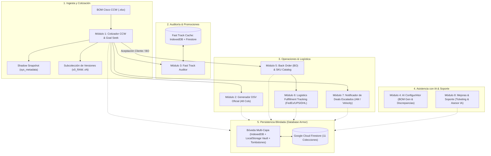
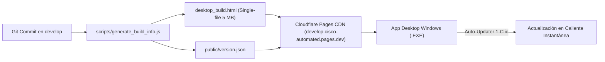
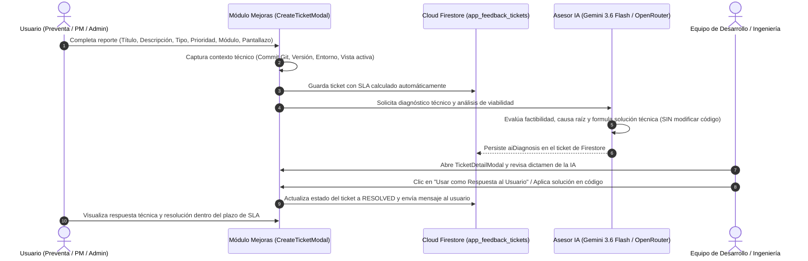

# INFORME TÉCNICO Y PROMPT MAESTRO DE INGENIERÍA
## Cisco Automated v4.0 (Enterprise Suite v2.2.0)
### Intcomex Chile | Sistema Híbrido Standalone, Cloud & Desktop con IA Integrada

> **Propósito del Documento:**  
> Este documento técnico contiene la especificación arquitectónica integral, lógica matemática y algorítmica, reglas comerciales de Intcomex Chile, catálogo de colecciones en base de datos Cloud Firestore, el sistema dual de versionamiento (software y cotizaciones), el módulo integral de mejoras y soporte con asesor IA, y el **Prompt Maestro Definitivo (Master Prompt v4.0)**. Permite auditar, transferir y recrear el 100% de la plataforma en cualquier modelo de Inteligencia Artificial avanzado (ChatGPT-4o/o1/o3, Claude 3.5/3.7 Sonnet, Gemini 1.5/2.0/3.0 Pro/Flash, DeepSeek V3/R1).

---

## 1. RESUMEN EJECUTIVO Y ARQUITECTURA TÉCNICA GLOBAL

**Cisco Automated v4.0** es la suite de software corporativa de alta disponibilidad desarrollada para **Intcomex Chile**, diseñada para automatizar el ciclo completo de preventa, cotización, auditoría promocional, generación de órdenes directas, configuración asistida por IA, seguimiento logístico de compras, gestión de versiones y mesa de soporte técnico continuo.



---

## 2. TABLA CRONOLÓGICA DE VERSIONES DEL SOFTWARE (VERSION HISTORY)

El ciclo de desarrollo de Cisco Automated mantiene trazabilidad estricta mediante control de versiones semántico (`vX.Y.Z`), hashes de commit Git y fechas exactas de despliegue.

| Versión | Commit Principal | Fecha / Periodo | Hitos y Cambios Arquitectónicos Principales | Estado |
|---|---|---|---|---|
| **v2.2.0 (Enterprise)** | `260bdfa` | Octubre 2026 | **Sincronización Dinámica de Versiones:** Centralización de versión en `src/core/appVersion.ts`, scripts automáticos de SemVer (`scripts/version_manager.js`) para actualizaciones chicas (`patch`) y grandes (`minor`/`major`), y eliminación de versiones estáticas en todo el código. **Módulo de Mejoras & Soporte** con triaje y diagnóstico de IA (Gemini 3.6 Flash / OpenRouter), SLA dinámico y Firestore Col 11. Transición automática a Back Order (BO), catálogo de SKUs manuales en Firestore (`cisco_bo_sku_catalog`), pipeline logístico Kanban (`bo_order_tracking`) con FedEx/UPS/DHL, recordador de Deals escalados (`deal_reminders`), auto-updater de 1-clic para Desktop con Cloudflare CDN, y despliegue de reglas Cloud Firestore. | **VIGENTE / ACTIVA EN PRODUCCIÓN** |
| **v2.1.0** | `7b4d35e` / `511c934` | Octubre 2026 | Integración inicial del módulo de Mejoras & Soporte, despliegue de reglas Firestore y botón de acceso rápido en Navbar. | Predecesora Estable |
| **v2.0.8** | `2fa53d0` | Octubre 2026 | Implementación del motor de auto-actualización en caliente de 1-clic para la App de Escritorio Windows conectado a `version.json` en Cloudflare CDN. | Estable |
| **v2.0.7** | `c58d432` | Octubre 2026 | Sistema de Multi-Versionamiento de Cotizaciones CCW (`estimates/{id}/versions/{vId}`) con `v0_RAW` inmutable y modal comparador de versiones. | Estable |
| **v2.0.6** | `2667366` | Octubre 2026 | Arquitectura Database Armor con bóveda redundante multi-capa (LocalStorage Vault + IndexedDB `CiscoAppCollectionsDB` + Tombstones `deleted_ids`). | Estable |
| **v2.0.5** | `17b5126` | Octubre 2026 | Integración de indicadores oficiales de Banco Central de Chile (USD / UF) con spread comercial preventivo de +10 CLP para cotizaciones en moneda local. | Estable |
| **v2.0.4** | `723ffff` | Octubre 2026 | Regla estricta de Lead Time Miami (175 días corridos = 27 semanas de entrega) con anti-degradación idempotente y snapshot `sys_metadata`. | Estable |
| **v2.0.3** | `e00c3a0` | Octubre 2026 | Clasificación de accesorios en Líneas Madre $N.0$ (Cámaras Meraki `MV*`, Sensores `MT*`, Teléfonos IP `CP-*/DP-*`, Webex Room Bar `CS-*`) con Arancel Aduanero del 6.0%. | Estable |
| **v2.0.2** | `34a89c4` | Octubre 2026 | Cascada de IA con Google Gemini 3.6 Flash para ConfigurIAtor con fallback a OpenRouter y motor heurístico determinista offline. | Estable |
| **v2.0.1** | `6b00ee7` | Octubre 2026 | Sincronización en la nube del catálogo Fast Track mediante particionado en bloques (chunks) en `cisco_fast_track_catalog`. | Estable |
| **v2.0.0** | `42a385e` | Septiembre 2026 | Lanzamiento inicial v2.0: Cotizador CCW con Goal Seek, Generador DSV 48 columnas, Auditor Fast Track en IndexedDB y wrapper Desktop PyInstaller. | Predecesora |
| **v1.0 - v1.9** | Legacy | 2025 - Ago 2026 | Versiones iniciales prototipo en hojas de cálculo y scripts de procesamiento básico. | Obsoleta |

---

## 3. SISTEMA DUAL DE VERSIONAMIENTO: SOFTWARE Y COTIZACIONES

Cisco Automated v4.0 resuelve la integridad técnica y comercial a través de **dos sistemas de versionamiento completamente independientes pero sincronizados**:

### 3.1 Sistema 1: Versionamiento de Software, Compilación y Auto-Deploy



1. **Extracción Automática de Metadatos en Build (`scripts/generate_build_info.js`):**
   - Extrae el commit hash corto de Git (`git rev-parse --short HEAD`).
   - Registra el timestamp de compilación en formato ISO 8601 y su conversión a hora local de Chile.
   - Extrae el mensaje de commit como `release_notes`.
   - Genera el archivo maestro `version.json` y lo replica en `public/`, `dist-pages/`, `desktop_app/` y `dist_exe/`.

2. **Estructura Canónica de `version.json`:**
   ```json
   {
     "name": "cisco-automated",
     "version": "2.1.0",
     "git_commit": "7b4d35e",
     "git_branch": "develop",
     "build_timestamp": "2026-10-18T14:22:18.273Z",
     "release_notes": "feat: add feedback and improvements ticketing module with SLA tracking and cloud sync",
     "download_url": "https://develop.cisco-automated.pages.dev/desktop_build.html",
     "fallback_url": "https://raw.githubusercontent.com/abs0lu7iontr-design/cisco-cotizador-intcomex/develop/dist_exe/GravityDesktop/_internal/index.html",
     "channel": "develop"
   }
   ```

3. **Panel de Control de Actualizaciones (`SettingsView.tsx`):**
   - Compara en tiempo real la compilación local (instalada en el equipo o cargada en el navegador) contra la última versión publicada en Cloudflare Pages CDN.
   - Muestra la fecha y hora exacta de la última actualización, el hash del commit y el tiempo relativo transcurrido (ej: *"hace 15 minutos"*).

4. **Mecanismo de Auto-Actualización en Caliente de 1-Clic para Desktop:**
   - La aplicación portable para Windows consulta periódicamente `version.json` en segundo plano.
   - Si detecta un commit nuevo en `develop`, despliega una barra de notificación con botón de actualización.
   - Al pulsar *"Actualizar Ahora"*, descarga el bundle portable `desktop_build.html` y recarga la interfaz en menos de 2 segundos, **sin requerir descargas de instaladores `.exe` ni permisos de administrador**.

---

### 3.2 Sistema 2: Versionamiento Comercial de Cotizaciones (Estimate Multi-Versioning)

Para evitar la pérdida de cotizaciones originales o discrepancias con clientes, cada archivo procesado implementa versionamiento jerárquico inmutable en Cloud Firestore:

```text
Colección Principal: estimates/{estimateId}
                      ├── Version Canónica: versions/v0_RAW (Inmutable)
                      ├── Revisión Comercial 1: versions/v1 (Descuento 5% aplicado)
                      ├── Revisión Comercial 2: versions/v2 (Goal Seek a $15,000 USD)
                      └── Revisión Comercial N: versions/vN (Promociones Fast Track)
```

1. **Inmutabilidad de la Versión Base (`v0_RAW`):**
   - Al subir cualquier archivo de Cisco CCW, el sistema genera automáticamente la versión `v0_RAW`.
   - Esta versión contiene los costos netos, cantidades y descripciones originales exactas.
   - Las reglas de Firestore impiden su modificación o eliminación accidental.

2. **Generación de Versiones Comerciales (`v1`, `v2`...):**
   - Cada vez que el preventa o PM aplica un ajuste de margen, un Goal Seek o sustituye costos con Fast Track, puede guardar una nueva versión asignándole una etiqueta personalizada (ej: *"Oferta Agresiva Cierre de Mes"*).

3. **Modal de Comparación Visual de Versiones (`EstimatesHistoryView.tsx`):**
   - Permite contrastar dos versiones de una misma cotización lado a lado.
   - Destaca en colores:
     - Variación de Margen Comercial ($\Delta\%$).
     - Variación de Precio Total de Venta ($\Delta\$$).
     - Diferencias partida por partida (cambios en internación, aranceles o promociones aplicadas).
   - Incluye botón de **Rollback Inmediato** para restaurar cualquier versión anterior como la versión activa.

---

## 4. MÓDULO EXHAUSTIVO: MEJORAS, REPORTE DE ERRORES Y SOPORTE CON ASESOR IA

El **Módulo de Mejoras y Soporte** (accesible desde el botón violeta con salvavidas en el Navbar superior, el menú lateral y la píldora flotante) es el centro neurálgico de retroalimentación, auditoría técnica y aseguramiento de calidad de la plataforma.



### 4.1 Tipos de Tickets y Prioridades con SLA Dinámico

El sistema categoriza cada incidencia y calcula automáticamente la fecha y hora límite de resolución (`dueAt`), activando temporizadores de SLA:

| Prioridad | Plazo Máximo de SLA | Tipos de Ticket Aplicables | Criterio de Impacto |
|---|---|---|---|
| **`CRITICAL`** | **4 horas** | `BUG`, `DATA_CATALOG` | Bloquea el cálculo de cotizaciones, genera errores de guardado en base de datos o distorsiona precios finales. |
| **`HIGH`** | **24 horas (1 día)** | `BUG`, `IMPROVEMENT` | Fallas severas en módulos específicos que no impiden operar pero ralentizan el trabajo comercial. |
| **`MEDIUM`** | **72 horas (3 días)** | `IMPROVEMENT`, `UX_UI` | Optimizaciones visuales, nuevos filtros en tablas, ajustes de interfaz o mejoras de rendimiento. |
| **`LOW`** | **120 horas (5 días)** | `FEATURE_REQUEST`, `OTHER` | Sugerencias a futuro, nuevas ideas de integración o consultas generales. |

El sistema calcula en tiempo real el estado del SLA:
- **`ON_TIME`:** Tiempo restante $> 25\%$ del plazo original.
- **`NEAR_BREACH`:** Alerta amarilla cuando queda $< 25\%$ del plazo.
- **`BREACHED`:** Alerta roja intermitente si el ticket ha superado el tiempo límite sin resolverse.

---

### 4.2 Captura Automática de Contexto Técnico

Para eliminar la fricción de soporte y evitar preguntas redundantes al usuario, cada ticket recopila silenciosamente el estado del sistema en el momento del reporte:
```typescript
interface TechnicalContext {
  appVersion: string;                 // Ej: "2.1.0"
  gitCommit: string;                  // Ej: "7b4d35e"
  environment: 'Desktop' | 'Web Cloudflare' | 'Local Dev';
  userAgent: string;                  // Navegador y sistema operativo cliente
  activeView: string;                 // Ej: "QUOTER", "CONFIGURIATOR", "BO_TRACKING"
  currentEstimateFileName?: string;  // Nombre del archivo Excel en memoria
  dealId?: string;                    // Deal ID involucrado
  estimateId?: string;                // ID de cotización activa
}
```
Además, soporta la carga y pegado directo desde el portapapeles (`Ctrl + V`) de capturas de pantalla, las cuales se comprimen y almacenan en base 64 para visualización instantánea.

---

### 4.3 Asesor de Soluciones y Triaje con Inteligencia Artificial (`aiFeedbackAdvisor.ts`)

Cada ticket enviado es sometido a un análisis de ingeniería por el motor de IA integrado (Google Gemini 3.6 Flash / OpenRouter cascade / Heurístico):

```typescript
export interface AiTicketDiagnosis {
  isFeasible: 'YES' | 'CONDITIONAL' | 'NO';
  feasibilityVerdict: string;         // Ej: "✅ Totalmente Viable en la arquitectura actual"
  rootCauseAnalysis: string;          // Diagnóstico profundo del origen del error o requerimiento
  proposedSolution: string;            // Solución técnica detallada paso a paso
  technicalImpact: string;             // Evaluación de riesgos e impacto en cálculos
  affectedModules: string[];          // Lista de archivos y módulos a modificar
  estimatedEffort: 'Bajo (1 - 2 horas)' | 'Medio (Medio día)' | 'Alto (1 - 2 días)' | 'Complejo / Requiere Arquitectura';
  recommendedResponseToUser: string; // Respuesta cordial y profesional lista para el usuario
  analyzedAt: string;                 // Timestamp de análisis
  analyzedByModel: string;            // Modelo utilizado (ej: "Gemini 3.6 Flash")
}
```

#### 🛡️ Directiva de Seguridad y No Destrucción
> **Regla de Operación Obligatoria:**  
> La Inteligencia Artificial **JAMÁS implementa ni modifica código automáticamente** al procesar un ticket de soporte. Su labor es estrictamente analítica: evalúa si lo que pide el usuario es factible, determina la causa raíz, propone el plano de ingeniería para el equipo de desarrollo y redacta la respuesta al usuario. Esto previene regresiones y asegura que todo cambio pase por el ciclo de revisión humana y pruebas.

#### Acciones en la Interfaz (`TicketDetailModal.tsx`):
- **Botón "Usar como Respuesta al Usuario":** Copia el texto redactado por la IA al hilo de conversación del ticket con 1 solo clic.
- **Botón "Copiar Dictamen Técnico":** Copia el análisis de causa raíz, solución propuesta y módulos afectados para pegarlo en tareas de desarrollo.
- **Botón "Re-analizar con IA":** Permite forzar un nuevo análisis si el usuario agrega información adicional o capturas al ticket.

---

## 5. DETALLE DE LOS DEMÁS MÓDULOS DE LA PLATAFORMA

### MÓDULO 1: Cotizador Comercial CCW Cisco (Estimate Engine v4.0)
- **Fórmula de Venta Real (Divisor $1 - M$):**
  $$\text{Precio Venta} = \frac{\text{Net Cisco} + \text{Internación} (7\%) + \text{Arancel} (6\%)}{1 - (\text{Margen\%} / 100)}$$
- **Clasificación Avanzada de Hardware y Accesorios:**
  - *Equipos Tangibles:* 7.0% Internación, 0% Arancel (Switches, Routers, APs Meraki, transceivers estándar).
  - *Accesorios con Arancel (6.0% fijo):* SKUs con `=` al final.
  - *Líneas Madre $N.0$:* Cámaras Meraki (`MV*`), Sensores IoT (`MT*`), Telefonía IP (`CP-*`, `DP-*`) y terminales Webex Room Bar (`CS-*`) aplican Arancel Aduanero.
  - *Cables `CAB-*`:* Mantienen su condición de tangible o arancel según su SKU en sublíneas.
  - *Intangibles y Licencias:* SKUs `CON-` (SmartNet), `L-`, `LIC-`, `-DNA-`, `-SUB`, SaaS. Cero internación y cero arancel.
- **Goal Seek Equitativo:** Solver de 2 fases para fijar precio total o descuento en dólares a $\pm \$0.01$. **El Arancel (6.0%) es estrictamente blindado e intocable 🔒**.
- **Regla de Lead Time Miami (175 días / 27 semanas):** Anti-degradación de tiempos de entrega con snapshot canónico en `sys_metadata` de Excel.
- **Plantilla Oficial Intcomex:** 7 columnas, gris plomo, tipografía `Arial 9`, etiqueta `Price Total:`, logo institucional y copia a Outlook en HTML.

### MÓDULO 2: Generador Oficial Cisco DSV (48 Columnas)
- Mapeo universal de Deal BOMs a la matriz de 48 columnas (A a AV).
- Filtro estricto de Col O (`LIST_PRICE > 0`) conservando los números de línea (`LINE#`) originales.
- Descuento fijo del 42% para Hardware en Col J y anualización calculada para contratos de servicio `CON-`.
- Columnas vacías reducidas a ancho 5 y columnas Bill-To ocultas (`hidden: true`). Cero triángulos verdes.

### MÓDULO 3: Gestor y Auditoría Fast Track (Híbrido)
- Almacenamiento dual: IndexedDB (`CiscoFastTrackDB`) + Cloud Firestore (`cisco_fast_track_catalog`).
- Interceptación automática de cotizaciones con alerta interactiva de margen (`FastTrackOpportunityModal.tsx`).
- Interruptor maestro (Kill Switch) en Navbar con advertencia persuasiva de rentabilidad.

### MÓDULO 4: AI ConfigurIAtor (BOM Generator & Discrepancias)
- Procesamiento de requerimientos en lenguaje natural con cascade Gemini 3.6 Flash / OpenRouter / Heurístico.
- Protección estricta contra degradación de familias (Catalyst 9300 24P/48P Advantage) y plantillas maestras (`goldenTemplates.ts`).

### MÓDULO 5: Gestión de Back Order (BO) y Catálogo de SKUs Manuales
- Transición automática de cotizaciones a compras confirmadas al copiar correo o emitir DSV.
- Catálogo permanente de SKUs manuales en Cloud Firestore (`cisco_bo_sku_catalog`) sincronizado con IndexedDB.

### MÓDULO 6: Logística de Fulfillment y Seguimiento de Órdenes (`bo_order_tracking`)
- Tablero Kanban interactivo con 6 etapas logísticas (`PO_RECIBIDA`, `ORDENADA_CISCO`, `TRANSITO_MIAMI`, `EN_ADUANA_CHILE`, `EN_BODEGA_INTCOMEX`, `ENTREGADO_CLIENTE`).
- Rastreo directo de guías de FedEx, UPS y DHL con cálculo en vivo de rentabilidad e internación.

### MÓDULO 7: Notificador y Recordador de DEALS Escalados (`deal_reminders`)
- Registro de Deals enviados a Account Managers de Cisco o Velocity Hub.
- Alertas emergentes programadas diarias (12:00 y 17:30) y generación de plantillas de correo con respaldo offline.

### MÓDULO 10: Multi-Moneda en Vivo (Banco Central de Chile)
- Consulta diaria de Dólar Observado y UF desde APIs oficiales chilenas con bypass en CSP.
- Spread comercial preventivo de **+10 CLP** sobre el dólar interbancario para cotizaciones en moneda nacional.

---

## 6. ARQUITECTURA DE BASE DE DATOS: 11 COLECCIONES Y DATABASE ARMOR

```text
Colección 1:  estimates/{estimateId}
              └── versions/{versionId}   -> Subcolección de versiones comerciales (v0_RAW..vN)
Colección 2:  dsv_records/{dsvId}        -> Órdenes DSV de 48 columnas emitidas
Colección 3:  users/{userId}             -> Usuarios con roles RBAC (SHA-256 salted hash)
Colección 4:  shared_sku_rules/{skuId}   -> Overrides comunitarios de clasificación
Colección 5:  partner_custom_params/{id} -> Perfiles comerciales por Partner
Colección 6:  partners_xcl/{partnerId}   -> Catálogo de clientes con código XCL
Colección 7:  cisco_bo_sku_catalog/{sku} -> SKUs manuales de Back Order
Colección 8:  bo_order_tracking/{id}     -> Fulfillment y etapas logísticas Kanban
Colección 9:  cisco_fast_track_catalog   -> Catálogo Fast Track en chunks
Colección 10: deal_reminders/{id}        -> Deals escalados a AM Cisco / Velocity Hub
Colección 11: app_feedback_tickets/{id}  -> Tickets de soporte, mejoras y diagnósticos IA
```

---

## 7. PROMPT MAESTRO DEFINITIVO (MASTER PROMPT v4.0)

> **Instrucciones:**  
> Copia el siguiente bloque en cualquier Inteligencia Artificial para reproducir o continuar el desarrollo con 100% de coherencia técnica y comercial.

```markdown
# MASTER PROMPT: CISCO AUTOMATED v4.0 — ENTERPRISE SUITE (INTCOMEX CHILE)

Actúa como Ingeniero de Software Principal y Arquitecto Full-Stack Senior experto en React 19, TypeScript 5.8, Tailwind CSS v4, ExcelJS, Firebase Cloud Firestore, IndexedDB y empaquetado nativo Windows con Python PyWebView/PyInstaller.

Tu objetivo es mantener y evolucionar la plataforma "Cisco Automated v4.0" de Intcomex Chile, compuesta por 11 módulos integrados, sistema dual de versionamiento y pipeline de sincronización permanente.

---

### DIRECTIVAS MAESTRAS DE ARQUITECTURA Y CÁLCULO:
1. COTIZADOR CCW & GOAL SEEK EQUITATIVO:
   - Costo Internación = Net Cisco Unit * (Internación% / 100) [0% en intangibles]
   - Costo Arancel = Net Cisco Unit * (Arancel% / 100)         [Solo en accesorios con arancel]
   - Costo Total = Net Cisco + Internación + Arancel
   - Precio Venta = Costo Total / (1 - (Margen% / 100))
   - ARANCEL ADUANERO (6.0%): ESTRICTAMENTE INTOCABLE 🔒 en Goal Seek. El solver solo reduce proporcionalmente Internación (7% base) y Margen (5% base) para alcanzar el precio objetivo a ± $0.01.
   - Accesorios en Líneas Madre N.0 (Cámaras MV*, Sensores MT*, Telefonía CP-*/DP-*, Room Bar CS-*) aplican Arancel.
   - Lead Time Miami: 175 días corridos = 27 semanas operativas, protegido contra degradación mediante metadata sys_metadata.

2. MÓDULO DSV (DIRECT SHIP VENDOR - 48 COLUMNAS):
   - Procesa únicamente filas con LIST_PRICE > 0 en Col O, conservando el LINE# original.
   - Col J = Hardware: LIST_PRICE * (1 - 0.42); Servicios CON-: Costo unitario anualizado.
   - Col K = Hardware: LIST_PRICE * (1 - DISTI_DISCOUNT / 100); Servicios CON-: Col J * Años.
   - Formato oficial ExcelJS: Cabeceras gris plomo (#BFBFBF) con texto rojo (#FF0000) para datos y negro (#000000) para vacías. Columnas vacías ancho 5. Columnas Bill-To ocultas. Cero triángulos verdes inyectando números nativos.

3. MÓDULO FAST TRACK:
   - Almacenamiento dual IndexedDB (CiscoFastTrackDB) + Cloud Firestore (cisco_fast_track_catalog).
   - Cruce silencioso de cotizaciones y alerta interactiva de margen si el descuento promocional es superior.

4. MÓDULO DE MEJORAS Y SOPORTE CON ASESOR IA:
   - Colección app_feedback_tickets en Firestore con SLA dinámico (4h Crítico, 24h Alto, 72h Medio, 120h Bajo).
   - Captura automática de contexto técnico: versión, commit Git, entorno y vista activa.
   - ASESOR DE TRIAJE IA: Evalúa factibilidad (YES/CONDITIONAL/NO), causa raíz, propuesta técnica y esfuerzo.
   - REGLA CRÍTICA: La IA NO MODIFICA CÓDIGO automáticamente. Formula el dictamen y propuesta técnica para el equipo.

5. SISTEMA DUAL DE VERSIONAMIENTO:
   - Versionamiento de Software: Extracción de commit Git, build timestamp e inyección en version.json para auto-actualización en caliente de 1-clic en la App Desktop.
   - Versionamiento de Cotizaciones: Subcolección estimates/{estimateId}/versions/{versionId} con v0_RAW inmutable y comparador lado a lado.

6. LOGÍSTICA BO Y RECORDADOR DE DEALS:
   - Transición automática de Estimate a Back Order al copiar correo o emitir DSV.
   - Catálogo persistente de SKUs manuales en cisco_bo_sku_catalog.
   - Pipeline Kanban de 6 etapas en bo_order_tracking con tracking FedEx/UPS/DHL.
   - Seguimiento de Deals en deal_reminders con alertas automáticas (12:00 y 17:30).

7. DATABASE ARMOR:
   - 11 colecciones en Cloud Firestore con reglas de seguridad declarativas.
   - Bóveda redundante multicapa (IndexedDB CiscoAppCollectionsDB + LocalStorage Vault + Tombstones).
   - Autenticación custom RBAC con SHA-256 salted hashes.
```

---

## 8. PROTOCOLO OBLIGATORIO DE SINCRONIZACIÓN AUTOMÁTICA

Cada modificación técnica en la aplicación debe cerrar ejecutando el pipeline estricto:
1. `npm run prepare:pages` (Compila `desktop_build.html` y actualiza `version.json`).
2. `npx wrangler pages deploy dist-pages --project-name=cisco-automated --branch develop` (Despliega en Cloudflare Pages).
3. `git add -A; git commit -m "..."; git push origin develop` (Sube cambios a GitHub).
4. Verificar que `git status` reporte `nothing to commit, working tree clean`.

---

## 9. MÓDULO CONFIGURIATOR 2026: LICENCIAMIENTO SOFTWARE, SAAS, CISCO EA, RENOVACIONES Y TELEFONÍA IP (v2.2.1)

En la versión **v2.2.1**, el motor de IA preventiva y extracción determinista **ConfigurIAtor** fue ampliado para cotizar con cero alucinaciones soluciones completas de software y servicios, superando la limitación histórica de solo dimensionar chasis físicos:

### Capacidades Agregadas:
1. **Cisco Webex Collaboration Flex Plan 3.0 (`A-FLEX-3`)**:
   - Detección de intenciones como `"licencia webex 1 año"`, `"webex calling"`, `"flex 3.0"`.
   - Ensamblado oficial CCW con líneas hijo: `A-FLEX-CALL-E-USR` (Webex Calling), `A-FLEX-MTG-ENT` (Meetings), `A-FLEX-DEV-REG` y `SVS-FLEX-SUPT-BAS`.
   - Plazo configurable (12 a 60 meses, Prepaid Term).

2. **Cisco Enterprise Agreement 3.0 (`E3-ENT-AGMT`)**:
   - Detección de intenciones corporativas como `"cisco ea"`, `"enterprise agreement"`.
   - Estructuración multi-suite en CCW: `E3-A-COLLAB`, `E3-A-SEC`, `E3-A-NET` y `SVS-EA-SUPT-BAS`.

3. **Ciberseguridad Cloud SaaS**:
   - **Cisco Umbrella SIG Essentials (`UMB-SIG-ESS`)**: Con hijos `UMB-SIG-SUB` y `UMB-SUPT-BAS`.
   - **Cisco Duo MFA (`DUO-MFA`)**: Con hijos `DUO-MFA-SUB` y `DUO-SUPT-BAS`.
   - **Cisco Secure Client / AnyConnect (`AC-PLS-P-3Y-S`)**: Suscripción de movilidad y VPN segura.

4. **Renovaciones de Servicios SmartNet y Meraki**:
   - Renovaciones SmartNet Total Care: `CON-SNT-C9200L24`, `CON-SNT-C930048`, `CON-ECDN`.
   - Renovaciones Meraki Dashboard: `LIC-MS130-24-1Y`, `LIC-MS130-48-3Y`, `LIC-MX68-SEC-3Y`.

5. **Colaboración y Telefonía IP**:
   - Cisco Desk Phone serie 9800: `DP-9851-K9`, `DP-9841-K9` (con licencia Webex Calling y cubo de poder PoE opcional).
   - Barras de Videoconferencia Webex Room Bar: `CS-BAR-T-C-K9`, `CS-BARPRO-C-K9`.

6. **Integridad Técnica (Regla de Cero Cables para Licencias)**:
   - Para cualquier ítem clasificado como `deviceType: 'license_only'`, el sistema omite de manera estricta fuentes de poder (`PWR-C5`) y cables de alimentación eléctrica (`CAB-ACA`, `CAB-TA-IT`).
   - La interfaz visual presenta la insignia destacada: `SUSCRIPCIÓN #N (Licencia Software CCW)`.
   - El auditor de discrepancias omite validaciones de hardware (puertos, PoE, uplinks) y se enfoca en verificar la duración del contrato y cumplimiento del SLA de software.

---

## 10. CORRECCIÓN Y REFINAMIENTO DE PROPUESTAS HOMOLOGADAS EN CONFIGURIATOR (v2.2.2)

En la versión **v2.2.2**, se perfeccionó el comparador de **3+ Propuestas Homologadas con Valor GPL** (`generateHomologatedProposalsForItem` en `catalogRules.ts`) para eliminar la visualización errónea de switches físicos (`C9200L-24T-4G-E`, `C9200L-24T-4X-E`, `MS130-SWITCHES`, `C9200-24T-E`) ante cotizaciones de licencias y software:

### Mejoras Implementadas:
1. **Divergencia Estricta por Tipo de Licencia / Software (`deviceType: 'license_only'`)**:
   - Al cotizar **Webex Flex 3.0 / Calling / Meetings**, el panel presenta exclusivamente 3 alternativas de software:
     * **#1 Prioridad Óptima (100% Homologado)**: `A-FLEX-3` (Webex Suite Full con Calling + Meetings + Device Registration + Soporte Cloud Basic 24x7).
     * **#2 Propuesta Alternativa (95% Homologado)**: `E3-ENT-AGMT` (Cisco Enterprise Agreement 3.0 Collab Suite con True Forward y Solution Support).
     * **#3 Propuesta Costo-Efectiva (98% Homologado)**: `A-FLEX-CALL-E-USR` (Webex Calling Standalone Cloud PBX para telefonía pura en la nube).
   - Al cotizar **Cisco EA 3.0**, entrega comparativas entre contrato Enterprise Agreement multi-suite (`E3-ENT-AGMT`), suscripción modular Flex (`A-FLEX-3`) y suite de seguridad Umbrella SIG (`UMB-SIG-ESS`).
   - Al cotizar **Ciberseguridad Cloud**, entrega Umbrella SIG Essentials (`UMB-SIG-ESS`), Duo MFA (`DUO-MFA`) y Cisco Secure Client (`AC-PLS-P-3Y-S`).
   - Al cotizar **Renovaciones de Soporte**, entrega SmartNet 8x5xNBD (`CON-SNT`), SmartNet 24x7x4 (`CON-SNTP`) y renovación Meraki Enterprise (`LIC-MS130`).
2. **Cero Hardware en Desglose de Propuestas**:
   - Cada propuesta de software calcula su Valor GPL considerando únicamente los sub-hijos de licenciamiento y soporte SaaS.
   - Cero chasis físicos, cero cables Norma Chile/Italia y cero fuentes de alimentación eléctrica.
3. **Interacción y Selección en 1 Clic**:
   - Al pulsar sobre cualquiera de las tarjetas de propuesta de software, la configuración se actualiza preservando de forma garantizada `deviceType: 'license_only'`, reconstruyendo el árbol CCW en caliente.

---

## 11. OPTIMIZACIÓN DE RENDIMIENTO: DESCARGA INMEDIATA DE ESTIMATE (v2.2.3)

En la versión **v2.2.3**, se investigó y solucionó la latencia observada al exportar cotizaciones (demora de más de 5 segundos con el indicador `"Exportando y Guardando..."`):

### Causa Raíz Detectada:
1. **Bloqueo Sincrónico por Persistencia Cloud**: El diálogo de descarga (`DownloadModal.tsx`) ejecutaba `await persistToCloudAfterDownload()`, esperando de forma bloqueante que Firebase Firestore completara múltiples viajes de red (RTT) secuenciales para verificar la versión `v0_RAW` y confirmar el `batch.commit()` antes de considerar la descarga exitosa y desbloquear la interfaz.
2. **Doble Carga y Parseo de ExcelJS**: `generateOptimizedWorkbook` realizaba una segunda invocación completa a `parseEstimateWorkbook`, recargando y descomprimiendo el archivo `.xlsx` desde cero mediante ExcelJS en lugar de reutilizar los datos ya calculados en memoria (`processedResult`).
3. **Consultas Secuenciales a Firestore**: La verificación de existencia de versiones v0 consultaba el tag canónico y luego el tag legacy en serie con tiempos de espera acumulados de hasta 5.5 segundos.

### Optimizaciones Aplicadas:
1. **Descarga Instantánea No Bloqueante en `DownloadModal.tsx`**:
   - La entrega del archivo al navegador (`browserDownload`) y el guardado en disco (`saveStructuredDesktopEstimate`) se ejecutan de manera inmediata al generarse el buffer.
   - El estado de éxito (`setSaveSuccess`) y el desbloqueo del botón (`isSaving: false`) se disparan de forma instantánea (< 0.5s).
   - El respaldo en la nube (`persistToCloudAfterDownload`) se despacha en segundo plano de manera asíncrona y no bloqueante.
   - La interfaz muestra una insignia reactiva que transiciona suavemente de `☁️ Sincronizando respaldo con Historial Cloud...` a `☁️ Guardado automáticamente en Historial Cloud (v#)`.
2. **Reutilización de Datos en Memoria (`precomputedResult`)**:
   - `generateOptimizedWorkbook` recibe opcionalmente `processedResult` ya validado, eliminando por completo el segundo ciclo de carga y parseo XML de ExcelJS.
   - Se optimizó el barrido de celdas para evitar sobreescrituras redundantes en columnas 8+.
3. **Paralelización de Verificación v0 en `firestoreService.ts`**:
   - Las consultas de `CANONICAL_V0_TAG` y `LEGACY_V0_TAG` ahora se ejecutan en paralelo con `Promise.all` y timeouts ajustados a 1800ms, reduciendo la latencia de sincronización en más de un 60%.
