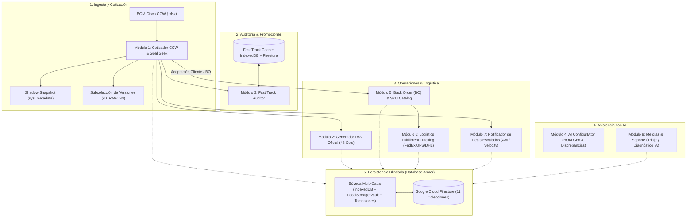

# INFORME TÉCNICO Y PROMPT MAESTRO DE INGENIERÍA
## Cisco Automated v4.0 (Enterprise Suite v2.1.0)
### Intcomex Chile | Sistema Híbrido Standalone, Cloud & Desktop con IA Integrada

> **Propósito del Documento:**  
> Este documento técnico contiene la especificación arquitectónica integral, lógica matemática y algorítmica, reglas comerciales de Intcomex Chile, catálogo de colecciones en base de datos Cloud Firestore, motor de auto-actualización en caliente, y el **Prompt Maestro Definitivo (Master Prompt v4.0)** actualizado. Permite auditar, documentar, transferir y recrear el 100% de la plataforma en cualquier modelo de Inteligencia Artificial avanzado (ChatGPT-4o/o1/o3, Claude 3.5/3.7 Sonnet, Gemini 1.5/2.0/3.0 Pro/Flash, DeepSeek V3/R1).

---

## 1. RESUMEN EJECUTIVO Y ARQUITECTURA TÉCNICA GLOBAL

**Cisco Automated v4.0** es la suite de software corporativa de alta disponibilidad desarrollada para **Intcomex Chile**, diseñada para automatizar el ciclo completo de preventa, cotización, auditoría promocional, generación de órdenes directas, configuración asistida por IA, seguimiento logístico de compras y soporte técnico continuo.



---

## 2. MAPA DE LOS 11 MÓDULOS DEL SISTEMA

### MÓDULO 1: Cotizador Comercial CCW Cisco (Estimate Engine v4.0)
- **Clasificación Multinivel de Hardware e Intangibles:**
  - *Equipos Físicos Tangibles:* Aplican 7.0% Internación base y 0% Arancel. Detecta familias Catalyst 1000/1200/1300, ISR 1100, switches, routers, APs Meraki, transceivers estándar.
  - *Accesorios con Arancel Aduanero (6.0% fijo):* SKUs terminados en `=` (cables `CAB-*=`, fuentes `PWR-*=`, racks, brackets).
  - *Accesorios en Líneas Madre (`N.0`):* Detección avanzada para cámaras de videovigilancia Meraki (`MV*`), sensores IoT (`MT*`), teléfonos IP (`CP-*`, `DP-*`) y terminales de videoconferencia Webex Room Bar (`CS-*`).
  - *Cables `CAB-*` en sublíneas:* Clasificados fielmente como Tangibles (sin `=`) o Arancel (con `=`) preservando su costeo sin forzar 0%.
  - *Intangibles, Licencias y Servicios:* SKUs `CON-` (SmartNet / SNT), `L-`, `LIC-`, `-DNA-`, `DNA-`, `-NW-`, `-SUB`, `A-FLEX`, licencias Meraki (`LIC-ENT`, `LIC-SEC`, etc.) y SaaS. Cero internación y cero arancel.
- **Fórmulas Comerciales de Costo y Venta Real (Divisor $1 - M$):**
  $$\text{Costo Internación} = \text{Net Cisco Unit} \times \left(\frac{\text{Internación\%}}{100}\right) \quad (\text{0\% en intangibles})$$
  $$\text{Costo Arancel} = \text{Net Cisco Unit} \times \left(\frac{\text{Arancel\%}}{100}\right) \quad (\text{Solo en accesorios con Arancel})$$
  $$\text{Costo Total Unitario} = \text{Net Cisco Unit} + \text{Costo Internación} + \text{Costo Arancel}$$
  $$\text{Precio Venta Unitario} = \frac{\text{Costo Total Unitario}}{1 - (\text{Margen\%} / 100)}$$
  $$\text{Precio Venta Extendido} = \text{Precio Venta Unitario} \times \text{Qty}$$
- **Ajuste Comercial de Precio Objetivo (Goal Seek Equitativo):**
  - Solver matemático bi-etápico (búsqueda binaria continua de alta precisión + afinamiento discreto de centavos) para alcanzar descuentos en dólares o precios venta totales exactos a $\pm \$0.01$.
  - **Regla Intocable:** El Arancel Aduanero (6.0%) está estrictamente blindado 🔒 y jamás se altera.
  - Ajuste equitativo y proporcional entre Internación (7.0% base) y Margen Comercial (5.0% base).
- **Reglas de Lead Time Miami (175 Días / 27 Semanas) y Anti-Degradación:**
  - Garantiza que los tiempos de entrega desde Miami no se degraden en recálculos sucesivos. Preserva la equivalencia de 175 días corridos a 27 semanas operativas.
  - Almacena el snapshot canónico original en metadatos ocultos de Excel (`sys_metadata`) garantizando el round-trip total al exportar y re-importar.
- **Exportación Multi-Plantilla Oficial:**
  - Excel Corporativo Oficial de 7 columnas estilizado con ExcelJS, cabeceras en gris plomo, celda totalizadora `Price Total:`, tipografía `Arial 9` y logo metálico institucional Intcomex.
  - Opción de descarga con desglose de servicios SmartNet (`CON-`) o vista simplificada.
  - Copia rápida en 1 clic de resumen para correo en HTML enriquecido para Microsoft Outlook con saludo dinámico por horario ("Buenos días", "Buenas tardes").

---

### MÓDULO 2: Generador Oficial Cisco DSV (Direct Ship Vendor - 48 Columnas)
- **Aislamiento Arquitectónico:** Reside en `src/modules/dsv/` sin dependencias cruzadas con el cotizador CCW.
- **Transformación de Deal BOMs:** Ingesta archivos `.xlsx` y `.xls` legacy.
- **Filtro Estricto de Precio:** Solo procesa filas con `LIST_PRICE > 0` en Columna O, preservando el número de línea original (`LINE#` como `1.0`, `1.1`, etc.) sin renumerar.
- **Lógica Financiera Diferenciada (Cols J y K):**
  - *Hardware y Suscripciones:* Col J aplica descuento fijo 42% (`LIST_PRICE * 0.58`); Col K aplica el descuento del Deal (`LIST_PRICE * (1 - DISTI_DISCOUNT / 100)`).
  - *Servicios Cisco (`CON-`):* Col J calcula el costo unitario anualizado; Col K multiplica dicho costo anual por la duración en años ($\ge 36$ meses = 41.41%; $\le 12$ meses = 37%).
- **Estructura Oficial de 48 Columnas (A hasta AV):**
  - Generación exacta de 48 cabeceras con fondo gris plomo (`#BFBFBF`) y textos en rojo (`#FF0000`) para columnas con datos y negro (`#000000`) para vacías.
  - Reducción de ancho a 5 para columnas vacías (`F, G, H, N, O, P, W, Z, AK, AN, AR, AU`).
  - Ocultamiento de columnas de Bill-To (`AB` a `AH`) con `hidden: true`.
  - Cero triángulos verdes de advertencia en Excel mediante inyección de valores numéricos nativos (`Number`) en SO (Col C), Deal ID (Col L) y PO (Col R).
- **Catálogo de Partners XCL:** Sincronizado en tiempo real con Firestore (`partners_xcl`) para autocompletar códigos de cliente Intcomex.

---

### MÓDULO 3: Auditoría y Catálogo Fast Track (Híbrido IndexedDB + Firestore)
- **Persistencia Híbrida Inteligente:**
  - *Almacenamiento Cliente Ultrarrápido:* IndexedDB (`CiscoFastTrackDB`) con lectura instantánea a 0 ms.
  - *Sincronización en la Nube:* Colección `cisco_fast_track_catalog` en Cloud Firestore, almacenando metadatos y chunks particionados para no exceder el límite de 1 MB de documento.
- **Interceptación Silenciosa de Oportunidades:**
  - Al cargar una cotización CCW, el auditor cruza cada SKU contra el catálogo promocional vigente.
  - Si un SKU tiene mayor descuento en Fast Track, levanta el modal interactivo de oportunidad de margen (`FastTrackOpportunityModal.tsx`).
  - Permite sustituir en memoria los costos con un clic, reflejando el badge ⚡ `FT` en la tabla comercial y recalculando márgenes en tiempo real.
- **Kill Switch de Seguridad y Modal Persuasivo:**
  - Interruptor maestro de activación en Navbar. Si el usuario intenta apagarlo teniendo promociones cargadas, el sistema alerta sobre la pérdida potencial de margen antes de proceder.

---

### MÓDULO 4: AI ConfigurIAtor (BOM Generator & Discrepancy Auditor)
- **Procesamiento de Lenguaje Natural (NLP Deductivo):**
  - Permite a los preventas redactar requerimientos en lenguaje natural (ej. *"Necesito 3 switches PoE de 24 puertos con 10G uplink y licencias Advantage por 3 años"*).
  - Infiere familias de producto exactas sin degradación de modelos (protección bidireccional contra degradaciones de Catalyst 9300 a modelos inferiores y preservación de 48 puertos).
- **Cascada Resiliente de Modelos de Lenguaje:**
  - Primario: Google Gemini (`gemini-3.6-flash` / `gemini-2.5-flash`) mediante SDK oficial `@google/genai`.
  - Secundario: Gateway OpenRouter con timeout extendido a 35s.
  - Fallback Offline: Motor heurístico determinista basado en catálogo de reglas (`catalogRules.ts`) y plantillas maestras (`goldenTemplates.ts`).
- **Auditor de Discrepancias:** Valida compatibilidad entre fuentes de poder, transceivers, cables de stacking y licencias requeridas por hardware.

---

### MÓDULO 5: Gestión de Back Order (BO) y Catálogo de SKUs Manuales
- **Aceptación y Transición Comercial de Cotizaciones:**
  - Cuando un cliente aprueba una cotización en el módulo CCW o al emitirse el DSV, la cotización se promueve formalmente a estado de compra / Back Order.
  - El sistema registra la aceptación y crea automáticamente el tracking de fulfillment en base de datos.
- **Catálogo de SKUs Manuales de Intcomex (`cisco_bo_sku_catalog`):**
  - Los productos que requieren mapeo a códigos de inventario local o que se cargan manualmente en el BO quedan persistidos permanentemente en Cloud Firestore.
  - No se pierden entre sesiones ni actualizaciones gracias al guardado transaccional y a la reconciliación bidireccional con IndexedDB.

---

### MÓDULO 6: Logística de Fulfillment y Seguimiento de Órdenes BO (`bo_order_tracking`)
- **Pipeline Kanban de Fulfillment:**
  - 6 etapas logísticas: `PO_RECIBIDA`, `ORDENADA_CISCO`, `TRANSITO_MIAMI`, `EN_ADUANA_CHILE`, `EN_BODEGA_INTCOMEX`, `ENTREGADO_CLIENTE`.
- **Integración con Couriers Internacionales:**
  - Seguimiento de guías FedEx, UPS, DHL y couriers locales con enlace directo de rastreo en 1 clic.
- **Métricas Financieras del BO:**
  - Monitoreo en vivo de Venta Total (USD), Margen de Ganancia Bruta, Internación y Aranceles comprometidos.
- **Event Sourcing Idempotente:**
  - Registro de auditoría cronológico de cada cambio de etapa y nota en `entity_events` evitando eventos duplicados mediante claves de idempotencia.

---

### MÓDULO 7: Notificador y Recordador de DEALS Escalados (AM Cisco / Velocity Hub)
- **Monitoreo de Aprobaciones Especiales:**
  - Registra Deals enviados a revisión por Account Managers (AM Cisco) o Velocity Hub (VF).
  - Colección `deal_reminders` en Cloud Firestore.
- **Alertas Proactivas Programadas (12:00 y 17:30):**
  - Modales emergentes automáticos en horarios clave de la jornada comercial alertando sobre Deals pendientes de aprobación.
- **Plantilla de Correo Automática con Respaldo Offline:**
  - Generador de correo preformateado en HTML/texto plano con el número de Deal, Partner, Cliente Final, descuento solicitado y fecha límite.
  - Fallback a `mailto:` local en caso de desconexión.

---

### MÓDULO 8: Mejoras, Reporte de Errores y Soporte con Triaje y Asesor IA
- **Gestión Integral de Tickets de Soporte:**
  - Colección `app_feedback_tickets` en Firestore con SLA dinámico por prioridad (`CRITICAL` = 4h, `HIGH` = 12h, `MEDIUM` = 24h, `LOW` = 48h).
  - Captura automática de contexto técnico: versión de la app, commit corto de Git, entorno (Web/Desktop), resolución de pantalla, vista activa y agente de usuario.
  - Soporte de capturas de pantalla adjuntas y conversación bidireccional entre usuario y equipo de desarrollo.
- **Asesor de Soluciones y Triaje con Inteligencia Artificial:**
  - Integrado en `src/modules/feedback/aiFeedbackAdvisor.ts`.
  - Evalúa la solicitud del usuario en 4 dimensiones clave:
    1. *Factibilidad:* Veredicto claro (`YES` / `CONDITIONAL` / `NO`) indicando si es viable realizar lo que solicita el usuario.
    2. *Diagnóstico de Causa Raíz:* Análisis técnico del origen del error o requerimiento.
    3. *Propuesta de Solución Técnica:* Diseño paso a paso de la arquitectura o código necesario para resolverlo.
    4. *Estimación de Esfuerzo:* `RAPID` (<2h), `MEDIUM` (1-2 días) o `COMPLEX` (3-5+ días) y módulos afectados.
  - **Aislamiento Preventivo:** La IA **únicamente formula el dictamen y la propuesta técnica**, sin aplicar modificaciones destructivas directas en el código fuente hasta que sea aprobado por el equipo de ingeniería.
  - Botón integrado *"Usar como Respuesta al Usuario"* para acelerar la atención de soporte con el feedback de la IA.

---

### MÓDULO 9: Historial Analítico, Multi-Versionamiento de Estimates y Comparador
- **Multi-Versionamiento Inmutable en Firestore:**
  - Subcolección `estimates/{estimateId}/versions/{versionId}`.
  - Versión base `v0_RAW` protegida contra sobrescritura como referencia canónica del archivo original subido.
  - Creación de versiones derivadas (`v1`, `v2`, etc.) al aplicar ajustes comerciales o Goal Seek.
- **Comparador Visual de Versiones:**
  - Modal interactivo para contrastar lado a lado diferencias de margen %, precios totales y variaciones línea por línea entre versiones.
- **Doble Opción de Descarga Histórica:**
  - Descarga del Excel oficial con formato Intcomex o descarga con discriminación de costos SNT/licencias.

---

### MÓDULO 10: Multi-Moneda y Tipo de Cambio Oficial Chileno (Banco Central de Chile)
- **Consulta en Tiempo Real de Indicadores Económicos:**
  - Consumo directo y seguro de APIs de tipo de cambio chilenas (`mindicador.cl`, `findic.cl`, `dolarapi.com`) con bypass en Content Security Policy (CSP).
- **Regla Comercial Intcomex (+10 CLP Spread):**
  - El valor del Dólar Observado (USD/CLP) incorpora automáticamente un spread de seguridad comercial de **+10 CLP** sobre el precio mayorista.
  - Conversión dinámica simultánea a Pesos Chilenos (CLP) y Unidades de Fomento (UF) en tablas de cotización y paneles de resumen.

---

### MÓDULO 11: Ecosistema Multi-Entorno, Auto-Deploy y Auto-Updater en 1-Clic
- **Web Standalone & Cloudflare CDN:**
  - Compilación optimizada a `dist-pages/` y despliegue global en Cloudflare Pages (`https://develop.cisco-automated.pages.dev`).
- **Desktop Portable Native (Windows .exe):**
  - Empaquetado portable con Python 3.14 + PyWebView 5.4 + PyInstaller en `dist/Cotizador-Cisco-Intcomex-Portable.exe` y versión modular `dist_exe/GravityDesktop/`.
- **Actualización en Caliente de 1-Clic:**
  - La aplicación de escritorio consulta periódicamente `version.json` en Cloudflare Pages.
  - Si detecta un nuevo commit de Git en `develop`, despliega una barra de notificación y botón de actualización en caliente.
  - Con 1 solo clic, la app descarga el nuevo bundle `desktop_build.html` y se actualiza al instante sin reinstalar el `.exe`.

---

## 3. ARQUITECTURA DE DATOS: 11 COLECCIONES EN FIRESTORE Y DATABASE ARMOR

La plataforma utiliza **Google Cloud Firestore** (modo producción) combinado con una bóveda multi-capa local (**Database Armor**) para garantizar cero pérdida de datos. No depende de Firebase Authentication; utiliza un sistema propio de **RBAC con SHA-256 salted hashes**.

```
Colección 1:  estimates/{estimateId}
              └── Subcolección: estimates/{estimateId}/versions/{versionId}
Colección 2:  dsv_records/{dsvId}
Colección 3:  users/{userId} (RBAC: admin, pm, user, viewer)
Colección 4:  shared_sku_rules/{skuId} (Overrides globales de clasificación)
Colección 5:  partner_custom_params/{paramId} (Parámetros comerciales por partner)
Colección 6:  partners_xcl/{partnerId} (Catálogo de clientes con código XCL)
Colección 7:  cisco_bo_sku_catalog/{skuKey} (Catálogo de SKUs manuales de BO)
Colección 8:  bo_order_tracking/{trackingId} (Logística de fulfillment y seguimiento)
Colección 9:  cisco_fast_track_catalog/{docId} (Catálogo Fast Track en chunks)
Colección 10: deal_reminders/{reminderId} (Recordatorios de Deals escalados)
Colección 11: app_feedback_tickets/{ticketId} (Tickets de soporte y triaje IA)
```

### Mecanismo de Bóveda Redundante (Database Armor)
1. **Doble Motor IndexedDB:** `CiscoAppCollectionsDB` para colecciones masivas de órdenes y eventos; `CiscoFastTrackDB` para catálogos de precios.
2. **Registro de Tombstones (`deleted_ids`):** Evita la reaparición no deseada de registros eliminados durante la reconciliación entre caché local y la nube.
3. **Caché Multi-Nivel:** `LocalStorage` (resumen de 0 ms) $\rightarrow$ `IndexedDB` (almacén estructurado) $\rightarrow$ `Cloud Firestore` (fuente canónica compartida).
4. **Respaldos de Recuperación ante Desastres:** Capacidad de exportar e importar instantáneas completas en formato JSON blindado.

---

## 4. STACK TECNOLÓGICO Y DEPENDENCIAS CLAVE

| Categoría | Tecnología / Librería | Versión | Propósito |
|---|---|---|---|
| **Frontend Framework** | React | 19.0.1 | Renderizado reactivo de última generación |
| **Lenguaje** | TypeScript | 5.8.2 | Tipado estricto de extremo a extremo |
| **Bundler & Tooling** | Vite | 6.2.3 | Compilación ultrarrápida y plugins singlefile |
| **Estilos & UI** | Tailwind CSS v4 + Lucide Icons | 4.1.14 / 0.546.0 | Diseño responsivo con soporte para modo oscuro |
| **Procesamiento Excel** | ExcelJS + SheetJS (XLSX) | 4.4.0 / 0.18.5 | Manipulación binaria de `.xlsx` y `.xls` legacy |
| **Almacenamiento Local** | IndexedDB API Nativa | Native | Almacenamiento local persistente de alta capacidad |
| **Nube & Base de Datos** | Firebase Cloud Firestore SDK | 12.18.0 | Persistencia modular sin listeners abiertos innecesarios |
| **Inteligencia Artificial** | Google GenAI SDK (`@google/genai`) | 2.4.0 | Integración directa con Gemini 3.6 Flash |
| **CDN & Serverless** | Cloudflare Pages & Wrangler | 4.127.1+ | Despliegue perimetral con alias `develop` |
| **Runtime Desktop** | Python + PyWebView + PyInstaller | 3.14 / 5.4 / 6.12 | Envoltura de aplicación nativa para Windows |

---

## 5. PROMPT MAESTRO DEFINITIVO (MASTER PROMPT v4.0)

> **Instrucciones de Uso:**  
> Copia y transfiere el siguiente bloque completo a cualquier Inteligencia Artificial avanzada para recrear, extender, depurar o auditar la aplicación con exactitud técnica absoluta.

```markdown
# MASTER PROMPT: CISCO AUTOMATED v4.0 — ENTERPRISE SUITE (INTCOMEX CHILE)

Actúa como un Ingeniero de Software Principal y Arquitecto Full-Stack Senior especializado en React 19, TypeScript 5.8, Tailwind CSS v4, procesamiento de hojas de cálculo con ExcelJS/SheetJS, Firebase Cloud Firestore, IndexedDB y sistemas desktop empaquetados con Python/PyWebView/PyInstaller.

Tu objetivo es desarrollar y mantener la suite "Cisco Automated v4.0" para Intcomex Chile, compuesta por 11 módulos integrados y sincronización automática permanente.

---

### REGLAS DE NEGOCIO Y CÁLCULOS COMERCIALES
1. FÓRMULA DE VENTA REAL (DIVISOR 1 - M):
   - Costo Internación = Net Cisco Unit * (Internación% / 100)  [0% en intangibles]
   - Costo Arancel = Net Cisco Unit * (Arancel% / 100)          [Solo en accesorios con arancel]
   - Costo Total Unitario = Net Cisco Unit + Costo Internación + Costo Arancel
   - Precio Venta Unitario = Costo Total Unitario / (1 - (Margen% / 100))
   - Precio Venta Extendido = Precio Venta Unitario * Qty

2. CLASIFICACIÓN DE PRODUCTOS:
   - Tangibles/Equipos: Switches, Routers, APs, chasis. Internación 7%, Arancel 0%.
   - Accesorios con Arancel (6.0% fijo): SKUs terminados en '=' (cables, fuentes, brackets).
   - Líneas Madre N.0 (1.0, 2.0..N.0): Cámaras Meraki (MV*), Sensores (MT*), Teléfonos IP (CP-*/DP-*) y Room Bar (CS-*) aplican Arancel.
   - Cables CAB-*: Conservan clasificación de tangible o arancel según tengan o no '='.
   - Intangibles/Servicios: SKUs CON-, L-, LIC-, -DNA-, -SUB, SaaS. Internación 0%, Arancel 0%.

3. GOAL SEEK EQUITATIVO (AJUSTE DE PRECIO OBJETIVO):
   - Solver bi-etápico (búsqueda binaria + afinamiento discreto de centavos) para alcanzar descuento ($) o precio venta ($) a ± $0.01.
   - EL ARANCEL ADUANERO (6.0%) ES ESTRICTAMENTE INTOCABLE 🔒.
   - Reduce proporcionalmente la Internación (base 7%) y el Margen (base 5%).

4. REGLA DE LEAD TIME MIAMI:
   - 175 días corridos = 27 semanas de entrega.
   - Anti-degradación idempotente y persistencia en metadata oculta sys_metadata.

5. MÓDULO DSV (DIRECT SHIP VENDOR - 48 COLUMNAS):
   - Solo procesa filas con Col O (LIST_PRICE > 0), conservando LINE# original sin renumerar.
   - Col J = Hardware: LIST_PRICE * (1 - 0.42); Servicios CON-: Costo unitario anualizado.
   - Col K = Hardware: LIST_PRICE * (1 - DISTI_DISCOUNT / 100); Servicios CON-: Col J * Años.
   - Formato ExcelJS: Tipografía Calibri 11, cabeceras en gris plomo (#BFBFBF) con texto rojo (#FF0000) para columnas con datos y negro (#000000) para vacías.
   - Columnas Bill-To (AB a AH) ocultas (hidden: true). Columnas vacías ancho 5.
   - SO (Col C), Deal ID (Col L) y PO (Col R) inyectados como Number nativo con numFmt = '0' (cero triángulos verdes).

6. MÓDULO FAST TRACK:
   - IndexedDB cliente + sincronización por chunks en Cloud Firestore (cisco_fast_track_catalog).
   - Intercepta cotizaciones CCW y alerta si el descuento promocional es mayor que el del BOM.
   - Botón maestro Kill Switch en Navbar con alerta persuasiva de rentabilidad.

7. MÓDULO BO & FULFILLMENT TRACKING:
   - Al aceptar cotización o enviar DSV, transiciona el Estimate a Back Order.
   - Catálogo de SKUs manuales persistido en cisco_bo_sku_catalog.
   - Pipeline Kanban de 6 etapas logísticas en bo_order_tracking con tracking FedEx/UPS/DHL.

8. MÓDULO DE MEJORAS Y SOPORTE (TICKETING & TRIAJE IA):
   - Colección app_feedback_tickets con SLA dinámico (4h a 48h) y contexto técnico automático.
   - Asesor IA (Gemini 3.6 Flash / OpenRouter / Heurístico): Evalúa factibilidad (YES/CONDITIONAL/NO), causa raíz, propuesta técnica y esfuerzo sin aplicar cambios en el código fuente.

9. PERSISTENCIA Y DATABASE ARMOR:
   - 11 colecciones en Cloud Firestore.
   - Subcolección estimates/{estimateId}/versions/{versionId} con v0_RAW inmutable.
   - Bóveda redundante multicapa (IndexedDB + LocalStorage Vault + Tombstones).
   - Autenticación custom RBAC con SHA-256 salted hashes.

10. PIPELINE DE DESPLIEGUE Y AUTO-ACTUALIZACIÓN:
    - npm run prepare:pages compila bundle desktop_build.html (5 MB) y genera version.json con metadatos de Git.
    - Despliegue en Cloudflare Pages: npx wrangler pages deploy dist-pages --project-name=cisco-automated --branch develop.
    - Auto-updater en caliente de 1-clic para la app de escritorio leyendo version.json de CDN.
```

---

## 6. ESTRUCTURA COMPLETA DEL PROYECTO

```text
Cisco-Automated/
├── .github/workflows/         # Automatización de CI/CD y firma de código
├── desktop_app/               # Bundle HTML y metadatos para la versión desktop
├── dist_exe/                  # Ejecutables y recursos de PyInstaller
├── public/                    # Iconos institucionales y version.json
├── scripts/                   # Scripts de generación de build info y prepare_deploy.js
├── src/
│   ├── assets/                # Logos metálicos Intcomex e imágenes del sistema
│   ├── components/            # Componentes globales de interfaz
│   │   ├── DashboardView.tsx         # Dashboard analítico con KPIs comerciales
│   │   ├── DownloadModal.tsx         # Modal de exportación de archivos
│   │   ├── EstimatesHistoryView.tsx  # Historial de cotizaciones con multi-versionamiento
│   │   ├── ExcelSheetPreview.tsx     # Previsualización fiel del Excel CCW
│   │   ├── InteractiveTable.tsx      # Tabla dinámica interactiva con menú contextual
│   │   ├── Navbar.tsx                # Barra superior con accesos directos y status de actualización
│   │   ├── ParameterSidebar.tsx      # Sliders comerciales y panel Goal Seek
│   │   ├── SettingsView.tsx          # Configuración del sistema y preferencias
│   │   ├── Sidebar.tsx               # Navegación principal lateral
│   │   └── SummaryCards.tsx          # Tarjetas KPI de márgenes y ventas
│   ├── core/                  # Núcleo comercial y matemático
│   │   ├── calculations.ts           # Motor de cálculo comercial, clasificador y Goal Seek
│   │   ├── excelEngine.ts            # Generador y parseador de Excel CCW con ExcelJS
│   │   ├── exportUtils.ts            # Utilidades de portapapeles y formatos Outlook
│   │   ├── store.tsx                 # Estado global reactivo
│   │   └── types.ts                  # Definiciones de tipos del cotizador
│   ├── hooks/                 # Hooks personalizados de React
│   │   ├── useEstimatesMirror.ts     # Sincronización en memoria de cotizaciones
│   │   └── usePartnerDatabase.ts     # Integración con base de datos de partners XCL
│   ├── modules/               # Módulos desacoplados del sistema
│   │   ├── bo/                       # Módulo de Back Order, Tracking y Deals Escalados
│   │   │   ├── boSkuCatalogService.ts   # Catálogo persistente de SKUs manuales en Firestore
│   │   │   ├── boTrackingService.ts     # Servicio de fulfillment logístico y etapas Kanban
│   │   │   ├── BoTrackingView.tsx       # Vista interactiva del Kanban de seguimiento
│   │   │   ├── BoRequestModal.tsx       # Modal de transición y pedido a Back Order
│   │   │   ├── dealReminderService.ts   # Servicio de Deals escalados a AM/Velocity Hub
│   │   │   ├── DealReminderView.tsx     # Gestión de recordatorios y alertas
│   │   │   └── DealReminderAlertModal.tsx# Modal emergente programado (12:00 y 17:30)
│   │   ├── cloud/                    # Persistencia en Google Cloud Firestore
│   │   │   ├── firebaseConfig.ts        # Configuración e inicialización del SDK
│   │   │   ├── firestoreService.ts      # Bóveda redundante y operaciones CRUD (11 colecciones)
│   │   │   └── partnerParamsService.ts  # Parámetros comerciales personalizados por partner
│   │   ├── configuriator/            # AI ConfigurIAtor (BOMs & Discrepancias)
│   │   │   ├── aiBomExtractor.ts        # Extractor NLP de requerimientos con IA
│   │   │   ├── aiDiscrepancyAuditor.ts  # Auditor de compatibilidad de hardware
│   │   │   ├── catalogRules.ts          # Reglas de compatibilidad y protección de modelos
│   │   │   ├── ConfiguriatorView.tsx    # Vista principal del módulo ConfigurIAtor
│   │   │   └── goldenTemplates.ts       # Plantillas maestras de arquitecturas Cisco
│   │   ├── dsv/                      # Generador Oficial Cisco DSV (48 Columnas)
│   │   │   ├── dsvBomParser.ts          # Parser universal de Deal BOMs (.xls / .xlsx)
│   │   │   ├── dsvEngine.ts             # Motor de cálculo financiero y exportador ExcelJS
│   │   │   ├── DsvModal.tsx             # Modal de ingreso y validación en vivo de órdenes
│   │   │   └── DsvView.tsx              # Vista previa interactiva de la matriz de 48 columnas
│   │   ├── fasttrack/                # Auditor y Catálogo Fast Track
│   │   │   ├── fastTrackDb.ts           # Almacenamiento local en IndexedDB
│   │   │   ├── fastTrackAuditor.ts      # Motor de cruce automático de cotizaciones
│   │   │   ├── FastTrackAdminModal.tsx  # Panel de administración del catálogo
│   │   │   └── FastTrackOpportunityModal.tsx # Alerta interactiva de ahorro de costos
│   │   ├── feedback/                 # Módulo de Mejoras, Soporte y Triaje IA
│   │   │   ├── aiFeedbackAdvisor.ts     # Diagnóstico de factibilidad y solución con IA
│   │   │   ├── CreateTicketModal.tsx    # Modal de creación de ticket con captura técnica
│   │   │   ├── feedbackService.ts       # Servicio Firestore para app_feedback_tickets
│   │   │   ├── FeedbackView.tsx         # Bandeja de entrada de tickets y SLA
│   │   │   └── TicketDetailModal.tsx    # Detalle del ticket con dictamen de la IA
│   │   └── storage/                  # Motor de almacenamiento y base de datos local
│   │       └── indexedDbCollectionStore.ts # Bóveda de eventos y colecciones en IndexedDB
│   ├── App.tsx                # Enrutador principal de vistas y barra de navegación
│   └── main.tsx               # Punto de entrada de React 19
├── firestore.rules            # Reglas de seguridad declarativas de Cloud Firestore
├── package.json               # Dependencias de npm y scripts de automatización
├── tailwind.config.js         # Configuración del motor Tailwind CSS
└── vite.config.ts             # Configuración de compilación web y single-file
```

---

## 7. PROTOCOLO OBLIGATORIO DE COMPILACIÓN, DESPLIEGUE Y GITHUB

Para asegurar la coherencia del ecosistema, cualquier modificación realizada en la aplicación debe culminar obligatoriamente ejecutando el siguiente pipeline:

1. **Compilar y Empaquetar Artefactos:**
   ```bash
   npm run prepare:pages
   ```
2. **Desplegar en Cloudflare Pages (CDN Global):**
   ```bash
   npx wrangler pages deploy dist-pages --project-name=cisco-automated --branch develop
   ```
3. **Sincronizar y Subir a GitHub (`develop`):**
   ```bash
   git add -A
   git commit -m "feat/fix/chore: descripción del cambio"
   git push origin develop
   ```
4. **Verificación de Integridad:**  
   Confirmar que `git status` reporte `nothing to commit, working tree clean`.
