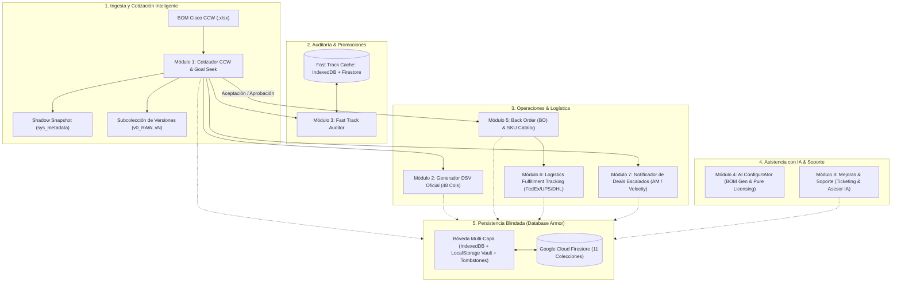
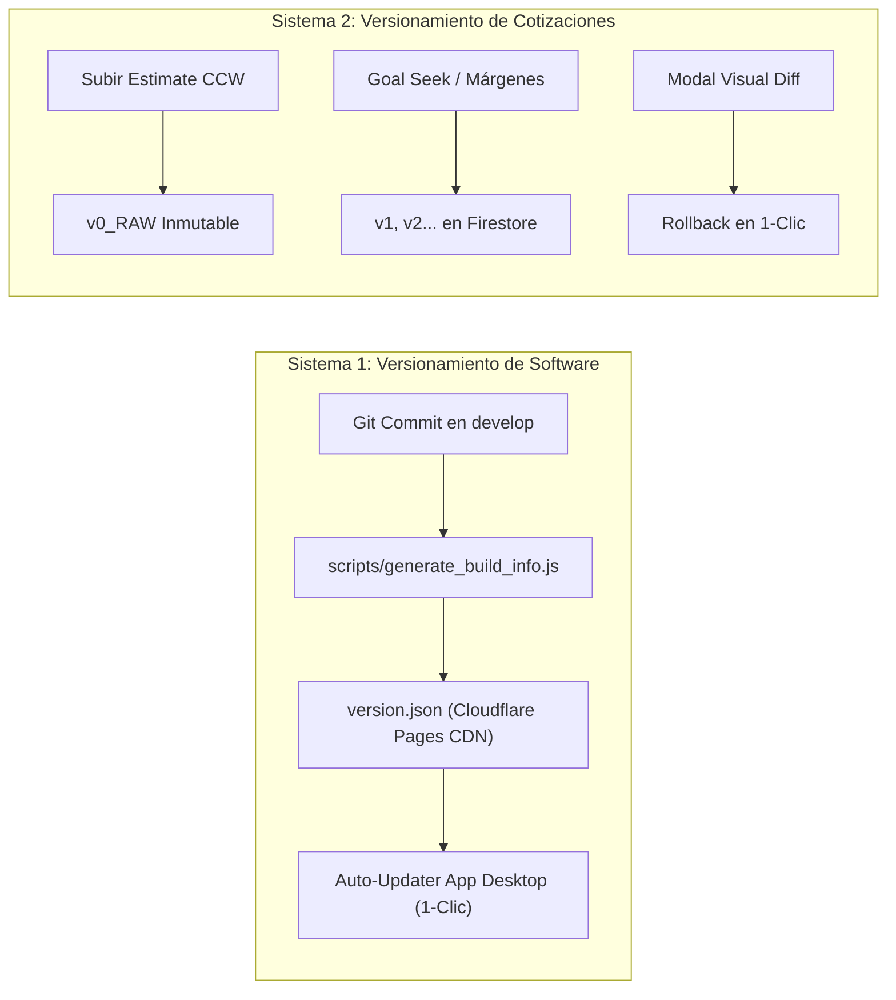

# Cisco Automated v2.4.5 (Enterprise Suite)
### Intcomex Chile | Plataforma Corporativa Híbrida Web Standalone, Cloud CDN & Desktop Portable con IA

[](https://develop.cisco-automated.pages.dev)
[](CHANGELOG.md)
[](https://react.dev/)
[](https://www.typescriptlang.org/)
[](https://vitejs.dev/)
[](https://tailwindcss.com/)
[](https://github.com/exceljs/exceljs)
[](https://firebase.google.com/)
[](https://pages.cloudflare.com/)
[](https://ai.google.dev/)
[](https://pywebview.flowrl.com/)
[](https://opensource.org/licenses/MIT)

---

## 🌟 Descripción General

**Cisco Automated v2.4.5** es la suite integral de software corporativo de alta disponibilidad diseñada y construida para **Intcomex Chile**, el distribuidor mayorista oficial de tecnología líder en la región. 

La plataforma automatiza de extremo a extremo todo el ciclo de ingeniería de preventa, cotizaciones oficiales de Cisco Commerce Workspace (CCW), optimización de margen sobre ventas, homologación de órdenes DSV, verificación de promociones Fast Track, diseño de arquitecturas con Inteligencia Artificial, logística de importación y Back Order (BO), y mesa de ayuda técnica con triaje predictivo.

Opera bajo una arquitectura híbrida de alta disponibilidad:
- **Cloud CDN Web (Cloudflare Pages):** Despliegue global en tiempo real en [https://develop.cisco-automated.pages.dev](https://develop.cisco-automated.pages.dev) con sincronización de estado y base de datos distribuida en Google Cloud Firestore.
- **Web Single-File Offline (`dist/index.html`):** Compilación autocontenida portátil de ~5.1 MB que opera 100% offline en cualquier navegador moderno sin requerir servidores locales.
- **App Desktop Portable Windows (`dist/Cotizador-Cisco-Intcomex-Portable.exe`):** Ejecutable nativo para Windows con **Auto-Updater en Caliente de 1-Clic**, almacenamiento estructurado local jerárquico (`gravity_storage/Partner/Cliente/Mes/`) y puente nativo PyWebView.

---

## 🏗️ Arquitectura Técnica y Flujo Integral



---

## ✨ Los 11 Módulos Principales del Sistema

### 1. Cotizador Comercial Cisco CCW (Estimate Engine)
* **Clasificación Multinivel de Partes:** Clasificación algorítmica de Hardware, Intangibles (Licencias, Suscripciones Cloud, Servicios `CON-`, SmartNet SNTC) y accesorios con arancel aduanero en líneas madre $N.0$ (Cámaras Meraki `MV*`, Sensores `MT*`, Teléfonos IP `CP-*/DP-*`, Webex Room Bar `CS-*`).
* **Fórmula Matemática de Margen Real sobre Ventas:**
  $$\text{Precio Venta Unitario} = \frac{\text{Net Cisco} + \text{Costo Internación} + \text{Costo Arancel}}{1 - (\text{Margen} / 100)}$$
* **Ajuste de Precio Objetivo (Goal Seek Equitativo):** Solver biseccional de 2 fases para fijar precio o descuento global manteniendo el **Arancel Aduanero (6.0%) blindado e intocable 🔒**.
* **Lead Time Miami (175 días corridos = 27 semanas):** Inyección no intrusiva de fecha estimada de despacho con anti-degradación idempotente y snapshot `sys_metadata`.
* **Descarga Instantánea (< 0.5s):** Motor de serialización ExcelJS con reuso de buffer precomputado y desacoplamiento asíncrono de persistencia en la nube.

### 2. Generador Oficial Cisco DSV (48 Columnas Oficiales)
* Conversión automática de cualquier cotización CCW a la matriz oficial de órdenes Direct Ship Vendor (DSV) requerida por Cisco Commerce:
  * Columnas A a AV homologadas.
  * Columnas J y K con anualización matemática de contratos `CON-`.
  * Filtro estricto de descarte de líneas informativas o de costo cero (`LIST_PRICE > 0`).
  * Formateo limpio sin triángulos verdes de Excel (IDs numéricos nativos con formato `'0'`).
  * Sanitización `.trim()` en todos los campos de texto para evitar rechazos en el portal de Cisco.

### 3. Gestor de Base de Datos y Auditoría Fast Track
* Cruce automático de cotizaciones en tiempo real contra el catálogo de descuentos promocionales Cisco Fast Track.
* Bóveda dual: persistencia local ultra-rápida en **IndexedDB** y sincronización comunitaria en **Cloud Firestore** (`cisco_fast_track_catalog`).
* Detección automática de SKUs bonificables con modal de adopción de ahorro en 1 solo clic.

### 4. AI ConfigurIAtor (BOM Gen & Licenciamiento Puro)
* Asistente de arquitectura con Inteligencia Artificial que traduce requerimientos en lenguaje natural a configuraciones de BOM Cisco completas.
* Cascada multi-proveedor: Google Gemini 3.6 Flash / Pro, OpenRouter (DeepSeek V3 / Qwen Free), Groq Cloud y motor heurístico determinista offline.
* **Soporte de Licenciamiento Puro:** Genera cotizaciones 100% cloud/software/SaaS (Webex Suite, Cisco Secure, Licencias Meraki Dashboard, Enterprise Agreement EA 3.0) sin forzar hardware físico cuando solo se requieren licencias.

### 5. Gestión de Back Order (BO) y Catálogo de SKUs Manuales
* Transición de cotizaciones aceptadas a órdenes de compra hacia Ventas Core.
* Asignación dinámica de bodega de despacho: Bodega E1 (Tránsito / Importación) vs Bodega ED (Nacional).
* Catálogo maestro de SKUs manuales persistido en Cloud Firestore (`cisco_bo_sku_catalog`) para evitar reingresos manuales repetitivos.

### 6. Logística de Fulfillment y Seguimiento (`bo_order_tracking`)
* Tablero Kanban operativo de 6 etapas: `Ingresado`, `OC Colocada`, `En Tránsito Miami`, `En Aduana Chile`, `En Bodega Intcomex`, `Entregado al Partner`.
* Trazabilidad directa de guías de courier internacional con enlaces nativos a **FedEx**, **UPS** y **DHL Express**.

### 7. Notificador y Recordador de Deals Escalados (`deal_reminders`)
* Monitoreo y seguimiento de oportunidades comerciales escaladas a Account Managers de Cisco o al Velocity Hub.
* Alertas proactivas automáticas dos veces al día: **12:00 (Mediodía)** y **17:30 (Cierre de Jornada)**.

### 8. Módulo de Mejoras, Reporte de Errores y Soporte con Asesor IA
* Sistema de ticketing y soporte técnico continuo alojado en la barra lateral izquierda:
  * SLAs dinámicos con conteo regresivo: Crítico (4h), Alto (24h), Medio (72h), Bajo (120h).
  * Adjuntos visuales y pegado directo de capturas de pantalla (`Ctrl + V`).
  * Diagnóstico y triaje predictivo asistido por IA (`aiFeedbackAdvisor.ts`): dictamen de factibilidad (`YES`/`CONDITIONAL`/`NO`), causa raíz técnica y tiempo estimado de resolución.

### 9. Historial Analítico y Multi-Versionamiento Comercial
* Subcolección jerárquica en Firestore (`estimates/{id}/versions/{versionId}`) con versión base inmutable `v0_RAW` intacta para auditorías.
* Modal comparador de versiones línea por línea con visualización de diff de margen y rollback en 1 clic.

### 10. Multi-Moneda en Vivo con Banco Central de Chile
* Conexión con indicadores oficiales del Banco Central de Chile (Dólar Observado y Unidad de Fomento UF).
* Incorporación de spread cambiario comercial preventivo de **+10 CLP** para proteger la rentabilidad en cotizaciones cerradas en moneda local.

### 11. Ecosistema Multi-Entorno & Auto-Updater de 1-Clic
* Despliegue en la red CDN de Cloudflare Pages y actualización en caliente de la aplicación de escritorio Windows: al detectar una nueva versión en la nube, el usuario se actualiza en 1 clic sin reinstalar el software.

---

## 🎨 Nueva Interfaz Minimalista y Ergonómica (v2.2.4 & v2.2.5)

En las versiones **v2.2.4** y **v2.2.5**, la interfaz gráfica fue sometida a una reingeniería completa para maximizar el espacio útil de trabajo y la ergonomía visual:

1. **Barra Superior Minimalista:**
   * **Botones Principales a la Izquierda:** Los botones `Subir Excel`, `Generar DSV` y `Descargar Excel` se reubicaron inmediatamente junto a la identidad corporativa `Cisco Automated`, eliminando el desplazamiento forzado hacia la esquina derecha.
   * **Supresión de Botones Redundantes:** Se eliminaron 7 botones secundarios del encabezado (`Reglas`, `Base Partners`, `Temas`, `Paleta`, `Fast Track`, `Reglas SKU`, `Mejoras & Soporte`) y el badge derecho de Intcomex, logrando un diseño limpio, moderno y despejado.
2. **Barra Lateral Izquierda como Centro Único:**
   * **Mejoras & Soporte Exclusivo:** El módulo de soporte reside única y exclusivamente en la barra lateral izquierda, suprimiendo botones flotantes invasivos en la esquina inferior.
   * **Centro "Sistema & Configuración":** Agrupación unificada de accesos directos con acordeón desplegable para abrir en 1 clic:
     * 📘 Reglas de Negocio CCW
     * 🏢 Base de Datos Partners XCL
     * 🔀 Reglas de Reclasificación SKU
     * ⚡ Catálogo y Promociones Fast Track
   * **Conmutador Visual Cyber HUD vs Enterprise Clean:** Disponible en el panel de Configuración para alternar entre una estética neón de alto contraste y un estilo corporativo clásico.

---

## 🗄️ Arquitectura de Persistencia y Base de Datos (11 Colecciones)

El almacenamiento se gestiona en **Google Cloud Firestore** bajo una arquitectura tolerante a fallos y sin expiración:

```text
1.  estimates                  -> Cotizaciones CCW maestras y metadatos comerciales
    └── versions               -> Subcolección de versiones comerciales (v0_RAW, v1, v2...)
2.  dsv_records                -> Órdenes DSV de 48 columnas generadas y exportadas
3.  users                      -> Usuarios RBAC con hash criptográfico SHA-256 (admin, pm, user, viewer)
4.  shared_sku_rules           -> Overrides comunitarios de clasificación de SKUs (Nube & Local)
5.  partner_custom_params      -> Perfiles de internación y márgenes personalizados por Partner
6.  partners_xcl               -> Catálogo de Partners y homologación de códigos de canal Intcomex XCL
7.  cisco_bo_sku_catalog       -> Catálogo persistente de SKUs manuales de Back Order
8.  bo_order_tracking          -> Fulfillment de órdenes BO y etapas logísticas Kanban
9.  cisco_fast_track_catalog   -> Catálogo Fast Track sincronizado por bloques (chunks)
10. deal_reminders             -> Recordatorios y seguimiento de Deals escalados (AM / Velocity)
11. app_feedback_tickets       -> Tickets de soporte, mejoras y diagnósticos emitidos por el Asesor IA
```

---

## 🔄 Sistema Dual de Versionamiento



---

## 📅 Historial y Tabla Cronológica de Versiones (Version History)

| Versión | Commit | Fecha | Hitos y Cambios Arquitectónicos Principales | Estado |
|---|---|---|---|---|
| **v2.3.0** | Pendiente | Octubre 2026 | **Versión Móvil PWA & Modo Pocket:** Barra inferior fija de navegación, tarjetas táctiles en el cotizador con drawer de desglose y reclasificación, compartir en 1 clic por WhatsApp con Web Share API, manifest PWA para pantalla completa en Android/iOS y preservación total de la experiencia de escritorio. | **VIGENTE / PRODUCCIÓN** |
| **v2.2.5** | `e4a460b` | Octubre 2026 | **Alineación Ergonómica y Eliminación de Badge Derecho:** Reubicación de los botones principales de flujo de trabajo (`Subir Excel`, `Generar DSV` y `Descargar Excel`) hacia la izquierda de la barra superior junto a la marca corporativa. Supresión definitiva del badge metálico `INTCOMEX Cisco Partner` del extremo derecho para una estética ultra-minimalista. | Estable |
| **v2.2.4** | `81f5354` | Octubre 2026 | **Reorganización Minimalista de UI & Consolidación en Barra Lateral:** Eliminación de redundancia en "Mejoras & Soporte" (dejándolo única y exclusivamente en la barra lateral izquierda; supresión del botón flotante inferior y del navbar). Consolidación de "Reglas CCW", "Base Partners XCL", "Reglas SKU" y "Fast Track" en un solo lugar bajo **Sistema & Configuración** en la barra lateral con acordeón de accesos directos y panel ejecutivo en `SettingsView`. | Estable |
| **v2.2.3** | `5f50fc6` | Octubre 2026 | **Descarga Instantánea de Estimates (< 0.5s):** Eliminación de latencia desacoplando la persistencia en la nube a una tarea asíncrona en segundo plano y reutilizando el buffer de ExcelJS precomputado en memoria sin doble re-descompresión. Paralelización de verificaciones Firestore `v0_RAW`. | Estable |
| **v2.2.2** | `f6bc548` | Octubre 2026 | **Soporte de Licenciamiento Puro en ConfigurIAtor:** Soporte para cotizaciones 100% cloud/software/SaaS (Webex, Cisco Secure, Meraki Lic, EA 3.0, SmartNet independiente) con guardias heurísticas en el prompt de IA para evitar inyección de hardware no solicitado. | Estable |
| **v2.2.0** | `260bdfa` | Octubre 2026 | **Sincronización Dinámica de Versiones & Soporte IA:** Centralización de versión en `src/core/appVersion.ts`, scripts automáticos de SemVer (`scripts/version_manager.js`) para actualizaciones chicas (`patch`) y grandes (`minor`/`major`). Módulo de Mejoras & Soporte con triaje predictivo de IA, SLA dinámico y Firestore Col 11. Transición a Back Order (BO), catálogo `cisco_bo_sku_catalog`, tracking Kanban `bo_order_tracking` con FedEx/UPS/DHL y recordador `deal_reminders`. | Estable |
| **v2.1.0** | `7b4d35e` | Octubre 2026 | Integración inicial del módulo de Mejoras & Soporte, despliegue de reglas Firestore y botón de acceso rápido en Navbar. | Predecesora |
| **v2.0.8** | `2fa53d0` | Octubre 2026 | Implementación del motor de auto-actualización en caliente de 1-clic para la App de Escritorio Windows conectado a `version.json` en Cloudflare CDN. | Predecesora |
| **v2.0.7** | `c58d432` | Octubre 2026 | Multi-Versionamiento de Cotizaciones CCW (`estimates/{id}/versions/{vId}`) con versión base inmutable `v0_RAW` y modal de comparación. | Predecesora |
| **v2.0.6** | `2667366` | Octubre 2026 | Arquitectura Database Armor con bóveda redundante multi-capa (LocalStorage Vault + IndexedDB + Tombstones). | Predecesora |
| **v2.0.5** | `17b5126` | Octubre 2026 | Integración de indicadores oficiales de Banco Central de Chile (USD / UF) con spread comercial preventivo de +10 CLP. | Predecesora |
| **v2.0.4** | `723ffff` | Octubre 2026 | Regla estricta de Lead Time Miami (175 días corridos = 27 semanas de entrega) con snapshot `sys_metadata`. | Predecesora |
| **v2.0.3** | `e00c3a0` | Octubre 2026 | Clasificación de accesorios en Líneas Madre $N.0$ (Cámaras Meraki, Sensores, Teléfonos IP, Webex Room Bar) con Arancel del 6.0%. | Predecesora |
| **v2.0.2** | `34a89c4` | Octubre 2026 | Cascada de IA con Google Gemini 3.6 Flash para ConfigurIAtor con fallback a OpenRouter y motor heurístico determinista. | Predecesora |
| **v2.0.1** | `6b00ee7` | Octubre 2026 | Sincronización en la nube del catálogo Fast Track por bloques (`cisco_fast_track_catalog`). | Predecesora |
| **v2.0.0** | `42a385e` | Septiembre 2026 | Lanzamiento inicial v2.0: Cotizador CCW con Goal Seek, Generador DSV 48 columnas, Auditor Fast Track y wrapper Desktop PyInstaller. | Predecesora |

---

## 🚀 Inicio Rápido, Construcción y Despliegue

### Requisitos Previos
* Node.js 20+ y npm 10+
* Python 3.10+ (solo si se compila el ejecutable nativo `.exe` de escritorio)

```bash
# 1. Clonar el repositorio
git clone https://github.com/abs0lu7iontr-design/cisco-cotizador-intcomex.git
cd cisco-cotizador-intcomex

# 2. Instalar dependencias
npm install

# 3. Iniciar servidor de desarrollo local
npm run dev

# 4. Compilar y empaquetar artefactos de actualización (Web + Desktop)
npm run prepare:pages

# 5. Desplegar en la nube (Cloudflare Pages)
npx wrangler pages deploy dist-pages --project-name=cisco-automated --branch develop

# 6. Compilar ejecutable nativo de escritorio para Windows
npm run build:desktop
# Genera: dist_exe/GravityDesktop/GravityDesktop.exe (~19.0 MB)
```

---

## 🛡️ Firma de Código (Code Signing) & Distribución Oficial

Las versiones ejecutables de escritorio para Windows de este proyecto son construidas y firmadas automáticamente mediante integración continua:
* **Code Signing:** Otorgado gratuitamente por [SignPath.io](https://signpath.io/) en representación de la [SignPath Foundation](https://signpath.org/).
* **Releases Oficiales:** Disponibles para descarga pública en la sección de [Releases de GitHub](https://github.com/abs0lu7iontr-design/cisco-cotizador-intcomex/releases).

---

## 📄 Licencia y Documentación de Ingeniería

* **Licencia:** Publicado bajo la licencia de código abierto [MIT License](LICENSE).
* **Informe Técnico Completo y Master Prompt de Recreación:** Ver [`INFORME_TECNICO_RECREACION_COTIZADOR_CISCO.md`](INFORME_TECNICO_RECREACION_COTIZADOR_CISCO.md).
* **Registro Formal de Cambios (Changelog):** Ver [`CHANGELOG.md`](CHANGELOG.md).
* **Historial Detallado de Releases:** Ver [`RELEASE_NOTES.md`](RELEASE_NOTES.md).
